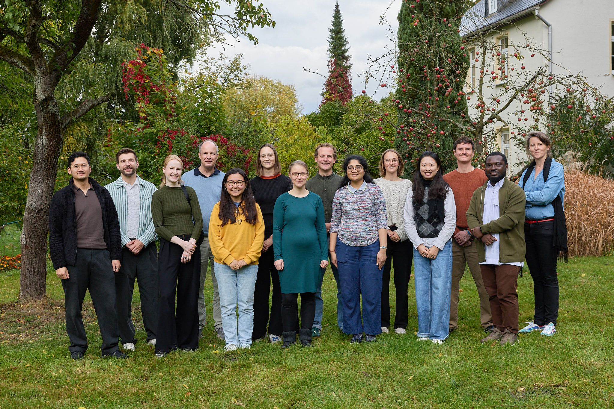
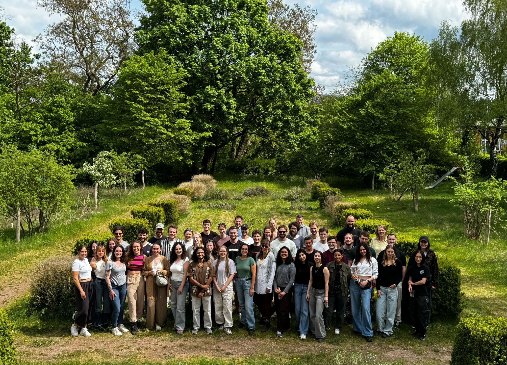



## Press Release of the Schering Foundation 

I am honored to be among the the awardees of the ScheringPlus Fellowship 2026 from the Schering Foundation!
[Press Release](https://scheringstiftung.de/wp-content/uploads/2026/10/Pressemitteilung_ScheringPlus_Fellowships_2026_Eng.pdf), photo by Bernhard Ludewig.
 
 

## Berlin Science Week 2026

My lab is again participating at [Berlin Science Week](https://berlinscienceweek.com/)! This year, 
the theme is: what does it mean for science to be In Touch? 👉 From the 1st to 10th November, 
Berlin Science Week is turning the city into a playground of scientific ideas, with more than 300 events. 
This year's festival theme "In Touch" is all about the personal side of science: how research touches our 
lives, how it changes us, and how it connects us with one another.  

Join us for our free lab tours "One Cell at a Time" at Berlin Institute of Health and Max Delbrück Center 
on the 4th or 5th of November. Find all information [here](https://berlinscienceweek.com/programme/one-cell-time-understanding-building-blocks-our-bodies) 
and explore the full programme.
 
 

## National Decade against Cancer at the Open Day of the Federal Ministry of Research, Technology and Space

On June 20 and 21, the Federal Ministry of Research, Technology and Space opens its doors to visitors. 
The weekend also kicks off Health XP, a nationwide touring exhibition for Science Year 2026 “Medicine 
of the Future.” On June 21 from 2 to 4 pm, I’ll be joining “Meet the Scientist” with the National Decade 
against Cancer in front of the Futurium to answer questions and share personal insights into my research!
 
 

## First-ever Single Cell Focus Area Retreat

On 4th and 5th of May 2026, our Single Cell Focus Area at the
Berlin Institute of Health at Charité Universitätsmedizin Berlin and the Max Delbrück Center
held its first-ever retreat, thanks to the support of the "Best Research Environment" award 
from Die Junge Akademie and the VolkswagenStiftung!  

Our retreat brought together scientists from the labs of Simon Haas, Ashley Sanders, 
Leif Ludwig and Stefanie Grosswendt for two inspiring days in Brandenburg, with the common goal 
of strengthening the supportive and collaborative research culture that this award celebrates. 